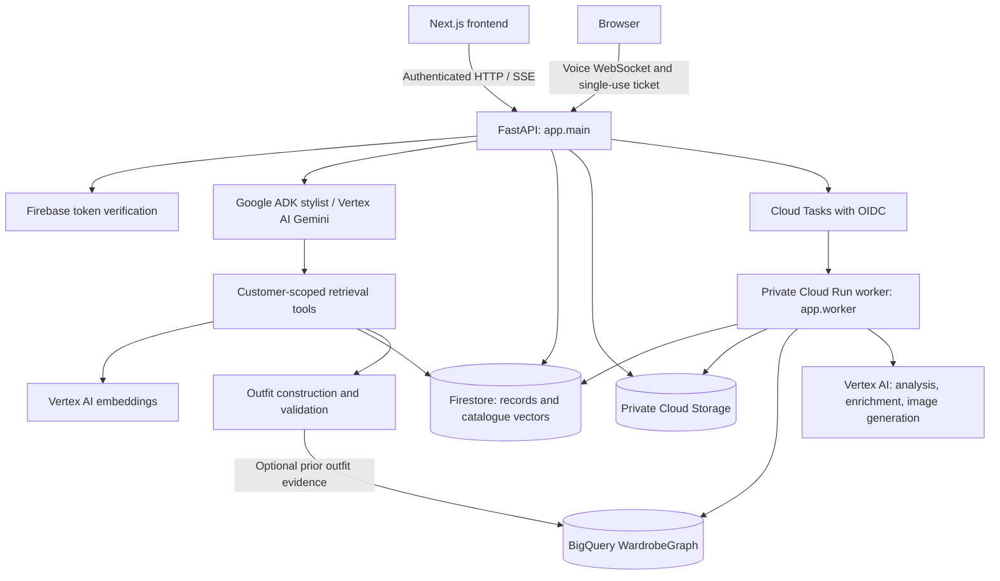

# Flairify backend

**The web app is in [Flairify-Frontend](https://github.com/samwin-steve/Flairify-Frontend), the repository linked in the submission. This repository contains its API, background worker, and technical documentation. Both repositories make up Flairify.**

[Live app](https://flairify-web-7kxckvikva-uc.a.run.app) · [API docs](https://flairify-api-7kxckvikva-uc.a.run.app/docs) · [Frontend setup](https://github.com/samwin-steve/Flairify-Frontend#run-locally)

Flairify recommends clothing outfits using an occasion, budget, saved sizes, and available inventory. Shoppers can optionally pair new products with confirmed wardrobe pieces, refine looks through text or voice, and generate 2D previews. Sellers can publish listings and manage stock. Checkout saves reviewed order records without payment or fulfillment.

This Python service owns authentication, catalogue retrieval, outfit validation, conversations, private media, seller access, and orders. A separate worker handles photo analysis, image generation, catalogue enrichment/indexing, and wardrobe graph updates.

## Architecture



Adapted from [Architecture and data flow](docs/ARCHITECTURE.md); [semantic retrieval](docs/SEMANTIC_RAG.md) documents the recommendation path in more detail.

### Main flows

1. **Recommendations:** the API loads the customer's saved shopping settings and conversation. The ADK stylist calls scoped tools to retrieve catalogue candidates using Vertex AI embeddings and Firestore vector search. The service builds and assesses complete outfits, then rechecks sizes, stock, ownership, and the total cost of all new pieces. Explanations stream over SSE; outfit cards come from validated records.
2. **Wardrobe pairing:** only confirmed garments enter recommendations. When enabled, BigQuery WardrobeGraph adds evidence from previously checked whole outfits. It does not determine current stock or authorize access.
3. **Photos and previews:** consented uploads become private media. Extraction produces draft garments for ownership review. Explicit preview requests create persisted jobs; Cloud Tasks invokes the private worker, which saves generated results for the frontend to retrieve.
4. **Seller listings:** approved sellers supply images, prices, variants, and stock. Background enrichment validates descriptive metadata and creates embeddings. Active, successfully indexed listings become eligible for shopping.
5. **Orders:** quote and placement endpoints re-read inventory and validate selected sizes, quantities, and totals. A request key prevents duplicate placement; customers and sellers receive appropriately scoped order views.

Firebase tokens and owner-scoped records protect private data. The worker accepts the configured task identity. Google Photos uses separate consent and authorization. Configured Model Armor checks screen text and voice tool actions; see [request safety](docs/MODEL_ARMOR.md).

## Run locally

Requires **Python 3.12–3.14** and **uv**. From a new working directory:

```sh
git clone https://github.com/samwin-steve/Flairify-Backend.git
cd Flairify-Backend
cp .env.example .env
uv sync --locked
uv run uvicorn app.main:app --reload --port 8000
```

Open [localhost:8000/docs](http://localhost:8000/docs) for the API reference or [localhost:8000/health](http://localhost:8000/health) for a health check. Run the [frontend](https://github.com/samwin-steve/Flairify-Frontend#run-locally) on port 3000 with `BACKEND_URL=http://127.0.0.1:8000`.

The supplied environment starts a credential-free demo: SQLite state and local media under `.data`, plus an in-process job executor. No separate worker process or Google Cloud resources are required. Choose **Browse as guest** in the frontend, save shopping preferences, and browse or ask for outfits. Optional sample wardrobe pieces must be confirmed before pairing.

### Demo and cloud configuration

| Setting | Purpose |
| --- | --- |
| `APP_MODE=demo`, `STORE_BACKEND=sqlite`, `DATA_DIR=.data` | Local persistence and isolated guest sessions. |
| `CORS_ORIGINS` | Allowed frontend origins; localhost ports are supplied in `.env.example`. |
| `ENABLE_PAID_AI=false` | Keeps the local demo free of paid model calls. |
| `DEMO_ADMIN_KEY` | Optional local secret for protected demo inventory access; set your own value. |
| `GOOGLE_CLOUD_PROJECT`, `FIRESTORE_DATABASE`, `MEDIA_BUCKET` | Cloud project, state database, and private media bucket. |
| `GEMINI_MODEL`, `IMAGE_EDIT_MODEL`, `LIVE_MODEL` | Explicit model IDs for chat/analysis, previews, and voice. |
| `WORKER_URL`, `TASK_SERVICE_ACCOUNT`, `TASKS_QUEUE` | Private worker and authenticated task delivery. |

See [`.env.example`](.env.example) for the complete configuration. Production requires Firestore, a private media bucket, Firebase authentication, runtime IAM, and approved model access. Models are enabled explicitly; setting a model name alone is not sufficient. The [integration guide](docs/INTEGRATIONS.md), [retrieval setup](docs/SEMANTIC_RAG.md#setup-and-migration), and [voice guide](docs/VOICE_STYLIST.md) cover these dependencies. `ALLOW_FIREBASE_IN_DEMO` supports signed-in users alongside guests in a configured cloud deployment; anonymous guests still do not consume paid models.

## Where the code lives

| Path | Responsibility |
| --- | --- |
| [`app/main.py`](app/main.py) | Public FastAPI routes and request orchestration. |
| [`app/worker.py`](app/worker.py) | Private task endpoint and caller verification. |
| [`app/auth.py`](app/auth.py) | Firebase/demo identity, role checks, owner scope, and quotas. |
| [`app/models.py`](app/models.py), [`app/config.py`](app/config.py) | Request/data schemas and environment settings. |
| [`app/store.py`](app/store.py) | SQLite and Firestore persistence. |
| [`app/agents/`](app/agents/) | Text and live voice agents, with customer-scoped tools. |
| [`app/prompts/`](app/prompts/) | Model instructions for styling and catalogue analysis. |
| [`app/rag/`](app/rag/) | Embeddings, vector retrieval, query planning, and wardrobe graph queries. |
| [`app/catalogue/`](app/catalogue/) | Metadata enrichment, taxonomy, image imports, and publication. |
| [`app/services/chat.py`](app/services/chat.py), [`conversation_context.py`](app/services/conversation_context.py) | Persisted conversations, streaming, deduplication, and look references. |
| [`app/services/recommendations.py`](app/services/recommendations.py), [`styling.py`](app/services/styling.py) | Outfit construction, assessment, and shopping constraints. |
| [`app/services/jobs.py`](app/services/jobs.py), [`try_on.py`](app/services/try_on.py), [`wardrobe.py`](app/services/wardrobe.py) | Job lifecycle, previews, and garment extraction. |
| [`app/services/inventory.py`](app/services/inventory.py), [`orders.py`](app/services/orders.py), [`sellers.py`](app/services/sellers.py) | Catalogue, checkout, and seller permissions. |
| [`app/services/media.py`](app/services/media.py), [`image_delivery.py`](app/services/image_delivery.py) | Private media storage and image derivatives. |
| [`fixtures/`](fixtures/) | Demo catalogue, source references, and image credits. |
| [`tests/`](tests/) | Pytest coverage for API flows, isolation, validation, and provider contracts. |
| [`scripts/`](scripts/) | Provisioning, indexing, catalogue imports, evaluation, and owner bootstrap. |
| [`infra/`](infra/) | Firestore indexes/rules, storage rules, Terraform, and BigQuery SQL. |
| [`docs/`](docs/) | Design notes, setup guides, limitations, and recorded verification. |

For a first code review, follow `app/main.py` → `app/services/chat.py` → `app/agents/stylist.py` → `app/agents/tools.py` → `app/services/recommendations.py`. For background work, start with `app/services/jobs.py` and `app/worker.py`.

## Tests

```sh
uv run pytest -q
uv run python scripts/evaluate_demo.py
```

Tests cover identity isolation, preferences, retrieval, conversation refinement, stock/size/budget checks, jobs, media, sellers, and order idempotency. Provider mocks test contracts; they are not live integration evidence. Recorded Google-service and deployed-browser checks are documented in [VERIFICATION.md](docs/VERIFICATION.md). Frontend browser tests live in the [frontend repository](https://github.com/samwin-steve/Flairify-Frontend/tree/main/tests).

## Deployment

The backend Docker image serves two Cloud Run services: public `flairify-api` and private `flairify-worker`. Cloud Tasks dispatches work using an OIDC service identity. Firestore stores application state; Cloud Storage holds private media. `cloudbuild.yaml` runs tests, builds the image, and deploys both services. The frontend has its own build and deployment pipeline.

The checked-in deployment targets project `data-workshops`, region `us-central1`, and the named Firestore database `flairify`. Follow [DEPLOYMENT.md](docs/DEPLOYMENT.md) to provision or adapt resources, identities, secrets, and build triggers. The documented triggers ignore README-only changes.

Seller access requires owner approval. To establish the first owner, a trusted operator can use [`scripts/grant_seller_access.py`](scripts/grant_seller_access.py) with the intended account's verified email after that account has signed in. The application runtime does not need identity-administration privileges.

## Capability boundaries

- Guest recommendations use deterministic rules. Uploaded photos require manual review without configured Gemini analysis; no detections or generated outputs are invented.
- Sample catalogue prices, sizes, and stock are simulated. Seller-supplied listings retain their facts. See [catalogue provenance](docs/CATALOGUE.md).
- Generated 2D previews illustrate styling; exact fit, product detail preservation, and extraction accuracy are not guaranteed.
- Checkout saves orders but does not charge, ship, reserve, or decrement stock.
- Voice requires a signed-in account and configured Gemini Live access. Transcripts persist; Flairify does not store voice audio.
- The AR mannequin is a sample asset. Google VTO and Veo adapters are experimental and do not have the same verification coverage as the Gemini 2D preview path. Google Photos still requires separate OAuth setup and end-to-end verification.

## Technical documentation

| Topic | Guide |
| --- | --- |
| System design and trust boundaries | [Architecture](docs/ARCHITECTURE.md) |
| Retrieval, ADK, streaming, and graph | [Semantic retrieval](docs/SEMANTIC_RAG.md) |
| Ranking and occasion handling | [Recommendation quality](docs/RECOMMENDATION_QUALITY.md) |
| Google services and runtime setup | [Integrations](docs/INTEGRATIONS.md), [deployment](docs/DEPLOYMENT.md) |
| Speech and request screening | [Voice stylist](docs/VOICE_STYLIST.md), [Model Armor](docs/MODEL_ARMOR.md) |
| Catalogue ingestion and metadata | [Enrichment](docs/CATALOGUE_ENRICHMENT.md), [photo imports](docs/PHOTO_CATALOGUE_IMPORT.md) |
| Image loading and caching | [Image delivery](docs/IMAGE_DELIVERY.md) |
| Evidence and remaining limits | [Verification](docs/VERIFICATION.md), [limitations](docs/LIMITATIONS.md), [costs and evaluation](docs/COSTS_AND_EVALUATION.md) |
| Judging walkthrough | [Demo script](docs/DEMO_SCRIPT.md), [submission notes](docs/SUBMISSION.md) |

See [LICENSE](LICENSE), [third-party notices](THIRD_PARTY.md), and [catalogue sources](fixtures/catalogue-sources.json) for licensing and attribution.
