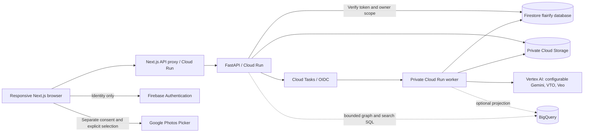

# Flairify architecture

Flairify starts with a customer-confirmed wardrobe, then suggests combinations of owned and available retailer pieces. It has two independently deployable repositories: Next.js frontend and FastAPI backend (including the worker).

## Trust boundaries

- Firebase ID tokens are verified server-side, including revocation, in production. Firebase `admin: true` is required for retailer operations. Google login is not Google Photos authorization.
- Credential-free demo sessions receive random bearer tokens. Only token hashes are persisted. Every demo has a separate wardrobe, private media, conversations and sample catalogue. A client-supplied user ID is never authorization.
- Every private lookup contains an owner namespace. SQLite enforces `(kind, owner, id)` keys locally; Firestore document IDs are hashes of `owner:id`, with owner-filtered list operations. Browser Firestore/Storage access is denied by rules.
- Media is delivered through an authenticated backend stream with `private, no-store`. Object paths never serve as public URLs. Product media has a separate retailer-scoped route that verifies a catalogue reference.
- A Cloud Tasks OIDC service identity is the only worker invoker. Workers also validate audience and caller identity. The model has only bounded read tools; save, generation and deletion need explicit customer actions through authorized endpoints.
- Raw photos and conversations are not written to application logs. Production Uvicorn access logging is disabled. Provider errors return a sanitized failure, never a fabricated result.

## State and media

Pydantic models cover UserProfile, ConsentSettings, ReferencePhoto, PhotoSource, WardrobeItem, DuplicateCandidate, Product, ProductVariant, Store, StockRecord, CompatibilityAssessment, Outfit, Conversation, Message, GenerationJob and SavedLook.

Photo import validates JPEG/PNG/WebP byte content, maximum size and decoded dimensions, corrects EXIF orientation, and saves a resized processing/evidence copy. Validated direct-upload originals remain private alongside the processing copy and available capture date. Google Photos retains the selected 1600px download, not a guarantee of full original resolution. Photo dates are evidence of appearance, not a complete wear history. Crops retain source IDs and normalized boxes relative to the selected-person image. Brand, material and size remain unknown unless provided by the customer. Thumbnails are evidence rectangles, **not segmented garments**.

Without Vertex credentials, uploaded photos produce a manual-review card, not invented detections. The sample wardrobe is a separate explicit choice. At least one garment must be confirmed, and import jobs finished, before personalized chat. Repeated imports preserve corrected records using deterministic item IDs.

## Jobs and concurrency

Cloud mode uses durable Firestore job state and Cloud Tasks. Local mode uses SQLite and a two-thread executor, with recovery on job-list reads. Jobs have queued/running/succeeded/failed/cancelled state, stages, attempts, leases and an idempotent request ID. A transaction claims each job. Generation requests charge a daily quota before work. Failed jobs allow at most three attempts, with no invisible repeated generation. Video operation names survive refresh and process restarts; Cloud Tasks polls long-running provider operations. Polling expires after 30 minutes. Cancellation deletes a completed result if a provider request finishes after the customer cancels.

Cancellation is best effort: an already-started provider operation may still incur a charge. Mid-request provider acceptance followed by a network failure can be ambiguous; no result is claimed successful. There is no cross-provider guarantee of exactly-once billing.

## Recommendations and graph

The server reads confirmed garments, interprets intent, bounds candidates, filters actual variants and stock, builds whole-outfit candidates, scores them, and re-reads current serving inventory before returning. Cost is the sum of **all** new pieces in each outfit. Sizes are explicitly customer-entered. Missing sizes cause a focused follow-up. Follow-ups preserve the active occasion and budget; “cheaper” reduces the active budget, “more relaxed” affects jacket selection, and “another jacket” excludes the previous primary jacket.

Graph nodes include user, wardrobe garment, retail product, outfit, occasion, style, store and source photo. Edges include ownership, consented preferences, source evidence, candidate complement, outfit membership, occasion and availability. Assessments carry a score, reason, source/version, timestamp, occasion and optional feedback. Only shortlisted combinations are stored. Compatibility is a hypothesis; a pairwise edge is not a whole-outfit guarantee.

Current serving graph is stored alongside application state. BigQuery schema, relational graph queries and parameterized product embedding projection are included. BigQuery Graph GQL requires Enterprise/Enterprise Plus reservations; this prototype uses ordinary SQL to avoid creating a reservation. BigQuery projections do not authorize media access or establish live stock. Personal graph projection is not automatically enabled; no unimplemented projection is advertised as active.

## UI

Light pink palette, serif headings and compact sans-serif controls. Desktop has navigation / conversation / outfit notebook. Small screens use bottom navigation, a sticky composer and dialogs for details. Radix handles modal focus trapping and Escape. React Hook Form + Zod validate style basics; TanStack Query maintains server state and job polling. The AR lab loads an original CC0 mannequin through model-viewer, checks AR availability and retains normal 3D controls when AR is unavailable.
